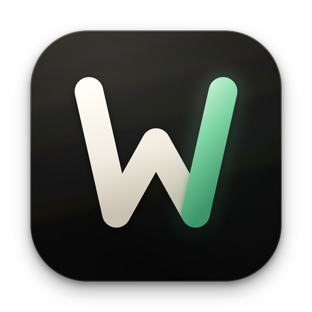
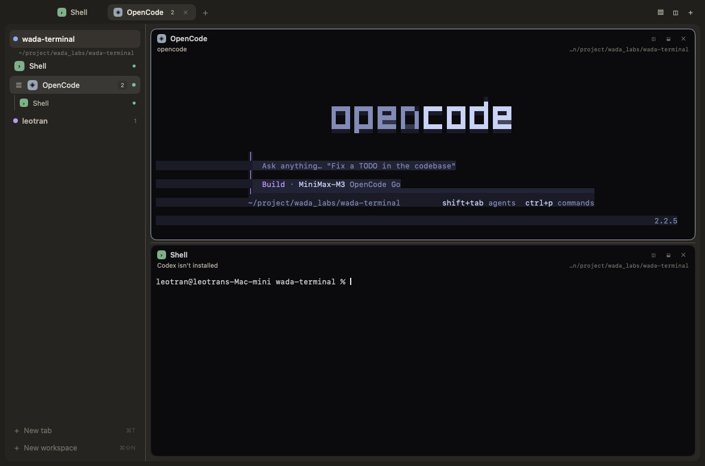
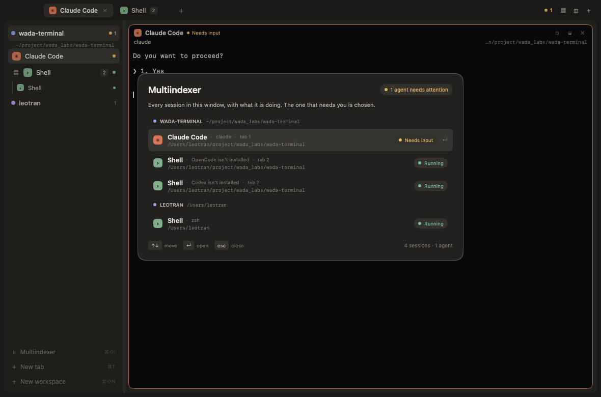

<p align="center"></p>

# Wada Terminal

A native terminal for coding agents, built with Go, [MyGo](https://mygo.egoist.dev)
and [wada-kit](https://github.com/xleotranx/wada-kit). Every pane is a real
program on a pseudo-terminal, and the window draws its cells itself — there is
no web view and no `xterm.js`. The programs run in a small core that outlives
the window, so closing it leaves your agents working.



## What it does

- **Tabs, splits and spaces** — `⌘T` opens a tab, `⌘D` splits right, `⌘⇧D`
  splits down, `⌘⇧W` closes the pane, `⌘1`–`⌘9` show a tab. A space is a folder
  with its own tabs: `⌘⇧N` adds one, `⌘⇧]` and `⌘⇧[` step between them, and they
  come back after a restart. `⌘B` hides the sidebar.
- **Which agent needs you** — a dot is green while an agent works, amber when it
  waits for an answer, blue when it finished unseen. `⌘⇧I` opens the Sessions
  view, one list of every session across spaces, tabs and splits, with the one
  that needs you chosen first.
- **Agents report their own state** — a program that speaks OSC 7501 tells the
  window what it is doing, with a label, a message and progress; any program
  that reports becomes an agent. Programs that never report get a quiet-screen
  fallback. Claude Code, Codex and OpenCode are started for you when installed;
  `agents.json` adds others.
- **Close it, they keep working** — the programs belong to a core process, not
  the window. Reopening attaches the window to the same terminals and the saved
  layout; a terminal the core lost comes back as a shell in its last folder.
- **A window an agent can drive** — `wada-terminal status`, `ls`, `commands`,
  `do` and `shot` talk to the running window over a local socket, and
  `wada-terminal skill` prints the guide for an agent.
- **The interface as files** — `settings.json`, `keys.json`, `layouts/`,
  `themes/`, `agents.json` and JavaScript mods in a config folder. Save a file
  and the window reloads it; a broken file keeps the last good version and
  writes an `.error` file beside it. Mod render functions describe the panel;
  persist state from click handlers, which save automatically.
- **Real terminals** — the emulator is Ghostty's, through MyGo's terminal view:
  24-bit color, the alternate screen, wide characters and emoji, the Kitty
  keyboard protocol, input methods, a reflowing scrollback, mouse reporting,
  selection and copy, `⌘F` find, `⌘`-click links, and split dividers you can
  drag. `⌘=` and `⌘-` change the text size.
- **Tasks and machines** — `⌘⇧T` queues an isolated task in a Git worktree, with
  review, checks and a finish flow. `core machine add vps --ssh vps` records
  another machine's core, and spaces and terminals can run there. Connections
  run in the background, so an unreachable machine leaves the window usable.



## Run from source

Wada Terminal is development software; macOS is the tested platform. Building
needs the Go version in [go.mod](go.mod), network access on the first build for
Go modules and MyGo's libghostty-vt, and `git` for task workspaces.

The app uses wada-kit v0.2.0. Its terminal plugin explicitly disables automatic
restart after a failure because Setup can start programs and restore sessions;
recovery must be an explicit action.

```sh
make run
```

`make run` and `go run .` run the development app; `go tool mygo dev .` adds
live reload. `make build` writes `dist/prod/wada-terminal`, `make build-dev`
writes `dist/dev/wada-terminal`, and `go tool mygo build` packages a production
app in `dist`.

The window hands panes your `PATH`. To run the CLI inside a pane, build it once
and add it:

```sh
make build-dev
export PATH="$PWD/dist/dev:$PATH"
```

Development and production use separate data, settings, sockets and cores. On
macOS their default folders are
`~/Library/Application Support/wada-terminal-dev` and
`~/Library/Application Support/wada-terminal`. `WADATERM_DATA_DIR` selects a
data folder for either environment, and `WADATERM_CONFIG_DIR` separately selects
the interface files. `WADATERM_CORE=off` keeps window-owned sessions, and
`WADATERM_CAPTURE=/path.png` writes a screenshot and quits (`WADATERM_TAB`,
`WADATERM_INDEX` and `WADATERM_WORKSPACES` choose what it shows,
`WADATERM_APPEARANCE=light` fixes the palette).

## Docs

- [docs/tasks.md](docs/tasks.md) — task workspaces, review, checks and finish.
- [docs/sessions.md](docs/sessions.md) — the Sessions view and its state
  model.
- [docs/performance.md](docs/performance.md) — where the time goes, and how to
  measure it.
- `wada-terminal skill` — the guide for an agent that drives the window.
- [AGENTS.md](AGENTS.md) — the source map and the rules the code follows.

## Known gaps

- There is no keyboard mode for moving through the scrollback and selecting
  text; the pointer, the wheel and the find bar do it.
- After a core restart or crash a pane comes back as a shell in its last
  folder, not as the agent and its work.
- The quiet-screen fallback can read an unfamiliar approval as idle, and a long
  silent spell of work as done. A program that reports over OSC 7501 is
  believed instead. There are no desktop notifications yet.
- Icons a program takes from a Nerd Font show as boxes when no such font is
  installed.
- A remote core's own saved spaces are not merged into this window, though its
  live terminals can be opened from the Machines panel.

## Contributing

Bug reports and focused pull requests are welcome; see
[CONTRIBUTING.md](CONTRIBUTING.md).

## License

MIT — see [LICENSE](LICENSE).
