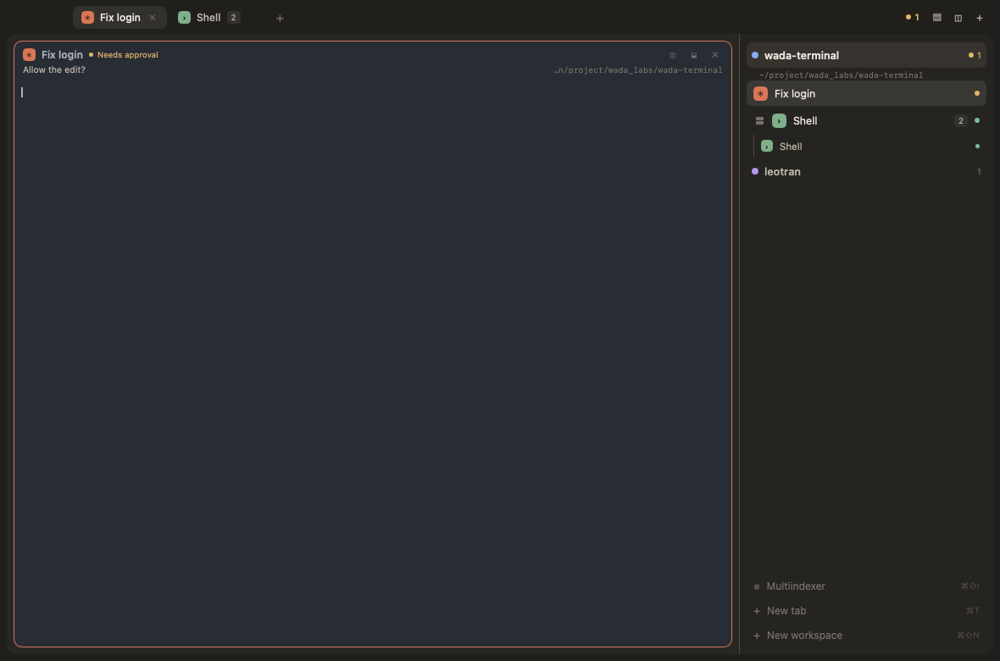
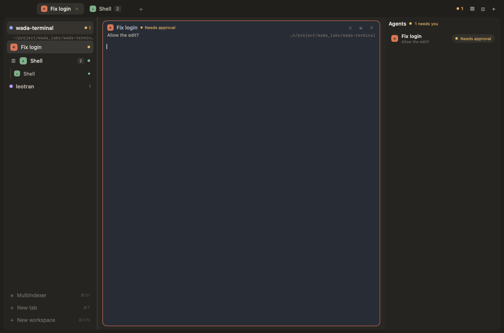
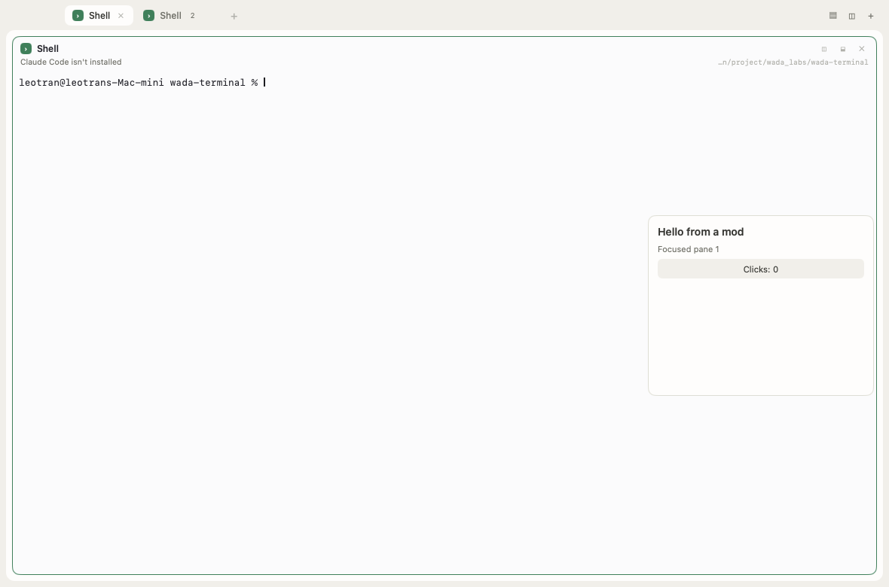
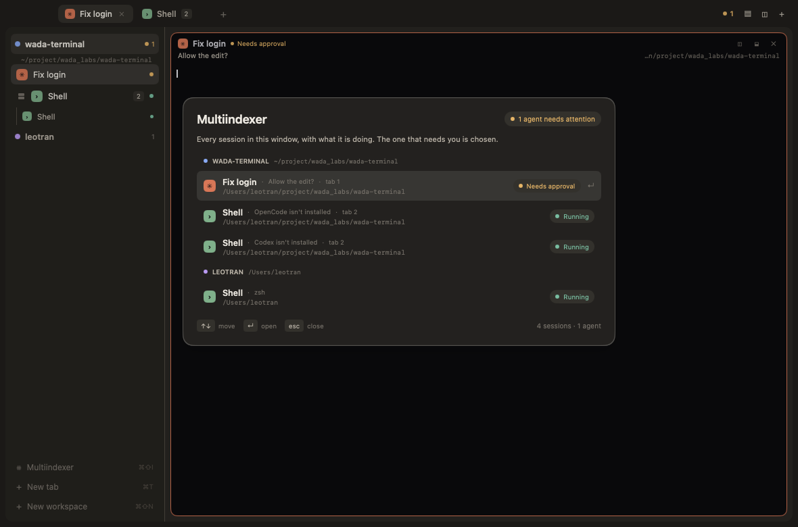
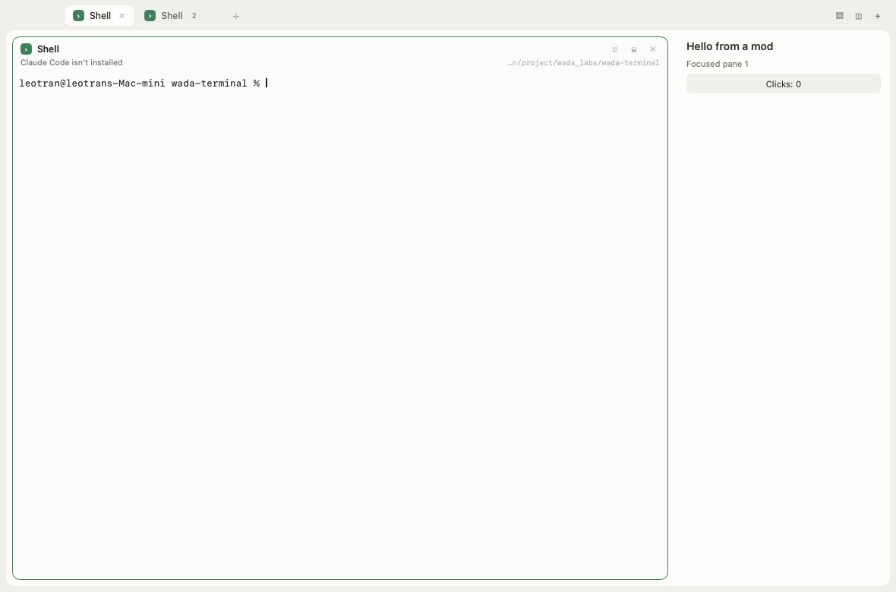
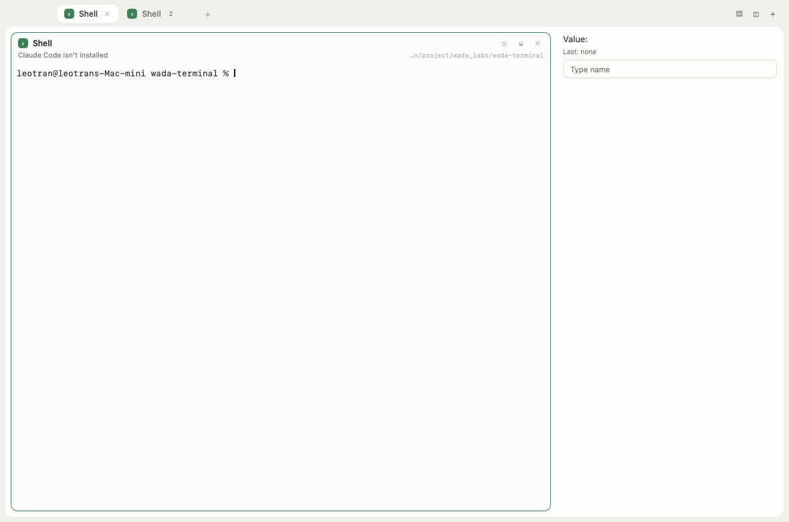

# The herdr-app port

This note records what [herdr-app](https://github.com/herdrdev/herdr-app) does,
what of it Wada Terminal has taken, and what is still to come. It is the second
research note: [sessions.md](sessions.md) took the agents index from
[herdr](https://github.com/herdrdev/herdr), the TUI. This one takes the
architecture of the newer desktop app.

## What herdr-app is

Herdr is a native desktop app for terminals and coding agents. Its pieces are
separate programs:

| Piece | What it is |
| --- | --- |
| `herdr-app` | The native window: spaces, tabs, panes, layouts, mods and the agents list. A GPUI client. |
| `herdr-core` (`hc`) | A small background server that runs every terminal and agent. It draws nothing and keeps running when the window closes. |
| Layouts and mods | The window's structure and its panels, as JSON and JavaScript files under `~/.config/herdr-app`. Agents edit the files; the window reloads them. |

Three ideas define it:

1. **The window is a client.** Terminals live in `herdr-core`, addressed as
   `t7` and labelled by the app (`herdr.space`, `herdr.tab`). Quitting,
   updating or crashing the window leaves them running; reopening the window
   reattaches. A machine can be added over SSH, and its core brings its spaces
   and agents into the same sidebar.
2. **Status is reported, not guessed.** A program sends OSC 7501, the Program
   Status Protocol: `state=working`, `blocked`, `done`, `idle` or `error`,
   optional `kind` (`permission`, `question`, `auth`), `progress` and base64
   `title` and `msg`. `herdr-core` stores exactly what was reported and never
   reads the screen. An agent is a terminal whose program reports.
3. **The interface is files.** `defaults/AGENTS.md` is written into the user's
   app home on every start: it teaches a person's agent the settings, keys,
   layouts, commands and mod API. The agents sidebar, tab bar, menus and
   dialogs are themselves mods, and an agent can change any of them.

Agents drive the window through the app's own CLI: `herdr-app status`,
`herdr-app ls`, `herdr-app commands`, `herdr-app do <action>` and
`herdr-app shot`. Core work (running, reading, messaging and waiting on
programs) is a different CLI, so the two surfaces stay separate.

## What Wada Terminal takes

Wada Terminal is one module with two roles. `wada-terminal` opens the MyGo
window; `wada-terminal --serve-core` runs a small background server that owns
the programs. The window starts a core when one is not already listening, and
attaches to its terminals. The port now has **the core**, **the status
protocol**, **the window's control API**, **the core command line with helpers
and machines**, **the interface as files**, **mods**, and **the layout tree**.

| herdr-app | Wada Terminal now |
| --- | --- |
| `herdr-core` owns terminals and outlives the window | Yes: `internal/core` runs programs on pseudo-terminals, keeps their screens, and survives the window. A detached process started from the app's own executable. |
| The window attaches to a live terminal and reattaches after a restart | Yes: the core sends a gob snapshot of the screen, then streams output; the app mirrors it. The saved layout names each pane's terminal. |
| A terminal that was lost (core restart, reboot) gets a shell in its folder | Yes. The saved core instance tells the window whether the ids it has still mean what they meant. |
| OSC 7501 status, stored as reported | Yes: `internal/vt/status.go` parses and stores records; `protocol.go` applies the seen rule; the pane, index, sidebar and the core's records show the report. |
| A program that reports is an agent, whatever its name | Yes. A shell that prints a 7501 report becomes an agent; an agent name is no longer required. |
| Programs and agents from a manifest | Partly: `agents.json`, and `programs.json` entries with `run`, add programs to the Session menu with argv, glyph, color, an SVG icon and `tint`; the window treats them as agents. A `match` list adopts an agent by its real foreground process on local and remote panes, falling back to the terminal title; core terminals report their foreground process through `core ls` and the Machines panel. |
| Find in a pane's scrollback | Yes: `⌘F` opens a find bar over the focused pane; search is case-insensitive over history and the live grid, highlights matches, and `↑`/`↓`/Return scroll to them. |
| A vi-like scroll mode | Partly: `⌃⇧Space` enters a mode where `j`/`k`, arrows, `g`/`G`, Page keys and `/` navigate history; `v` starts a character-wise selection (`h`/`l`, `w`/`b`/`e`, `0`/`$` move within it), `V` selects whole lines, `y` copies, `p` pastes into the program, `d` clears the selection, and `q`/Esc leaves; terminal text is never deleted. |
| Links before opening | Yes: OSC 8 links are underlined and click to open; hovering shows the URL in a pane-foot bar, and `⌘⇧L` lists every URL on the focused screen and its scrollback with keyboard choice. |
| Unreported programs have no status | Not quite: Wada Terminal keeps its screen-reading fallback for programs that never report. Once one reports, the fallback is off for good. |
| `herdr-app status/ls/commands/do` over a local socket | Yes: `internal/control` holds the protocol and action list; `internal/plugins/terminal/control.go` serves it; `internal/cli` is the command. |
| `herdr-app skill` writes the agent guide | Yes: `wada-terminal skill` prints `internal/cli/skill.md`. |
| A core CLI (`hc run/send/read/wait`) | Yes, the smaller set: `wada-terminal core ls/run/send/read/wait/kill/report/templates/events`, addresses (`t7`), names, exit codes, `WADA_TERMINAL_ID`, `wait --children [--any]` and tagged helper notes. Templates carry a command, readiness, submit key and instructions. `--on MACHINE` reaches a remote core. |
| Screenshots for agents (`shot`) | Yes: `wada-terminal shot [file.png]` asks the window for its last frame over the control socket and writes the PNG. The shell exposes an optional `Capture` method; a kit without it still compiles and says the window cannot be captured. |
| Layouts, keys, themes and mods as files | Mostly: `settings.json`, `keys.json`, `layouts/<name>.json`, `themes/<name>.json`, `mods/<name>/main.js` and an installed `AGENTS.md`, applied on save with the last good version kept. A layout is a row/column/stack tree of Workspaces, Panes, Agents and mod blocks; fixed-pixel blocks have draggable dividers. |
| Mods written in JavaScript | Yes, a small API: a trusted script's `render(api)` returns a tree of rows, columns, text, buttons, inputs and scrolls; `click(id, api)` can update state, read `api.inputs` and run window actions. Transforms and `api.animate(ms)` give simple animation. It is not gpui-kit and has no imports or web view. |
| Helpers (`hc run --bg`, `hc send`, child reports) | Mostly: `core run --bg`, `core send`, `core read`, `core wait`, `core report`, `core wait --children [--any]`, `core events`, `core run --template`, `core ask`, `core answer` and `core questions` work. A child's exit, report and blocked state arrive in the parent's input tagged with its address; a question does too, and the child waits for the answer. `--on MACHINE` works for remote helpers too. |
| SSH machines in one sidebar | Mostly: `space.new --machine MACHINE` runs their tabs and splits on a remote core and shows them with a badge; a `machines` layout block lists each machine's live terminals and opens one in this window; `--on` reaches the same core from the CLI. A remote core's own saved spaces are not merged. |

### The core

`internal/core` is a Unix-socket server. It owns each program on a
pseudo-terminal together with a `vt.Screen`, answers the queries that program
asks, and keeps the screen up to date while no window is attached. A window
starts it through `core.Ensure`: if `core.sock` does not answer, the app runs
its own executable with `--serve-core`, detached in a new session. The core
writes `core.json` (its instance id and pid) and `core.log` beside the socket.

Attaching is a framed binary stream, not JSON:

1. the viewer sends `{"method":"attach","terminal":7,...}` and its size;
2. the core sends a gob-encoded `vt.Snapshot`, the whole screen including
   scrollback, modes and OSC 7501 records;
3. the core streams the program's output; the viewer sends input and resizes on
   the same connection.

The app mirrors the screen with the same `vt.Screen` it paints. It does not
answer the program's queries; the core does, once, so a program never waits on
a window that is closed. If an attach connection breaks while the program
lives, the window attaches again and replaces its mirror with a fresh snapshot.

The window saves its spaces, tabs, splits, focus, and each pane's core terminal
id in the `terminal` plugin's `workspaces` setting. It also saves the core
instance those ids came from. On start, ids are used only when the instance
matches; otherwise every pane starts a shell in its last folder, as herdr-app
does after a core restart. Closing a pane or tab still ends its terminal;
closing the window only detaches. Set `WADATERM_CORE=off` to run the
window-owned sessions from before the core existed.

### The interface as files



The window writes and reads a config folder: `wada-terminal config path` prints
it. `AGENTS.md` is rewritten on every start and describes the rest:

| File | What it changes |
| --- | --- |
| `settings.json` | font size, appearance, theme, layout, optional sidebar flag |
| `keys.json` | every command's shortcut, by command id |
| `layouts/<name>.json` | a row/column/stack tree of Workspaces, Panes, Agents and mods |
| `themes/<name>.json` | the terminal cells' background, foreground, cursor, selection and sixteen ANSI colors |

A watcher compares modification stamps once a second and reloads on the UI
thread. A save that does not parse keeps the last good values, writes
`settings.error`, `keys.error`, `layout.error` or `theme.error` beside the
file, and shows a toast. Keys are applied by disposing the command scope and
contributing the commands again, so the menu and its shortcuts change together.
A theme is believed over the window's own light and dark palettes for the
terminal cells; the chrome keeps following the system palette.





A layout's leaves are the built-in blocks. The example above is one row:
`workspaces` at 220 px, `panes` with weight 1, and `agents` at 270 px. Sizes,
minimums, maximums, gaps, padding, palette backgrounds and `hidden` are read
from the file. The older `sidebar` shape becomes the same row, so existing
files keep working.

A float is a mod in a frame over the page:

```json
{"type": "float", "id": "hello", "mod": "hello", "edge": "right",
 "align": "center", "width": 300, "height": 240, "offset": 12}
```

It takes no layout room and can sit on any edge. The pointer drags it from any
part of its frame except a button or input, and the offset is saved per window.
With `peek`, a side-edge float starts as a narrow `⋮ id` strip and opens while
the pointer is over it. With `snap: true`, releasing a drag springs it to the
nearest of the four edges; herdr's edge thirds and custom spring curves are not
here.

This is the smaller half of herdr-app's idea. The leaves are four built-in
blocks plus mods, and the chrome is arranged by rows, columns, stacks and
draggable floats rather than by mods. See
[`internal/config/AGENTS.md`](../internal/config/AGENTS.md), which is the same
guide written into a user's folder.

### The status protocol



`internal/vt/status.go` implements the protocol's limits and validation:

- a report replaces its record; the record without an `id` is the program's
  own, and an `id` with slashes is a child of another;
- `state=clear` removes a record and its children, or every record without an
  id;
- `kind` is read only for `blocked`, and `progress` (0–100) only for `working`
  and `blocked`;
- `title` and `msg` are base64, at most 192 and 2048 bytes after decoding, and
  must be UTF-8 with no control characters;
- malformed pairs and unknown keys are skipped, but a bad id, a bad state or a
  bad text discards the whole report;
- `ESC ] 7501 ; ? ESC \` is answered with the states and kinds the window
  accepts.

The pane carries the last report. The window applies herdr's seen rule, copied
from `src/model.rs`: working and blocked mean the agent has not finished; when
it leaves those words, it is seen only if its pane had the keyboard and the
window was in front. An unseen finish is **Done** until the user looks. A
blocked report's kind names what it waits for (approval, answer or login), and
`error` is shown as blocked, as herdr-app shows it.

### The control API

The window listens on `$WADATERM_DATA_DIR/terminal.sock` (or the app's data
folder), mode 0600. One connection carries one JSON request and one response.
Requests are `status`, `ls`, `commands` and `do`; `do` takes one of the actions
in `internal/control/actions.go`. The same action list is what `commands`
prints, so a client never has a different idea of the API from the window.

A request is read by a worker and answered on the UI thread. Workers never
look at the window's state.

```sh
go run . status
go run . ls
go run . do pane.split --direction right --kind shell --pane 4
go run . do terminal.send --terminal 4 --text "go test ./..."
go run . skill
```

Space in the code is a workspace in the interface; the control API uses
herdr-app's word.

### Seeing the window

`wada-terminal shot [file.png]` saves what the window last rendered. The
window holds its own GPU frame, so this works while it is covered and needs no
screen-recording permission. The app gets it through an optional host method,
not the public `shell.Host` interface: a kit without capture still builds, and
the command says the window cannot be captured. This is the agent's visual
check after editing a theme or layout.

### The core command line

The core has its own client, so a program does not need the window to live:

```sh
wada-terminal core ls
wada-terminal core run --bg --name build -- make test
wada-terminal core read build --lines 100
wada-terminal core send build "rerun the failing package"
wada-terminal core wait build
wada-terminal core report "reviewed src/x.go; one bug"
wada-terminal core wait --children --timeout 300
wada-terminal core templates
wada-terminal core run --bg --template reviewer "Review src/x.go"
wada-terminal core kill build
```

`run` without `--bg` streams the program and exits with its code; `--bg` prints
the address and returns. A terminal is `t7` or the `--name` it was started
with. Inside a core terminal, `WADA_TERMINAL_ID` is its address and
`WADA_PARENT_ID` names the terminal that started it. `read` works after the
program ended too, while the core still holds the terminal.

A background child's exit is typed into its parent's input as
`<wada from="t7 reviewer" exit="0">finished</wada>`, a blocked child as
`<wada from="t7 reviewer" state="blocked">…</wada>`, and `core report` sends a
message the same way. `core wait --children` waits until no child is working or
blocked; `--any` returns on the next news. `core events` streams created,
changed and exit events as JSON lines. Templates in `templates/<name>.md` supply
a command, a readiness rule, a submit key and instructions; `core run
--template` sends the body and task after the program reports ready.

A helper can ask its parent and block:

```sh
# inside the helper's terminal
answer=$(wada-terminal core ask "Which file should I edit?")
```

The parent's input gets a tagged note and the exact command:

```sh
wada-terminal core answer t7 --question q1 "src/x.go"
```

`core questions [--child t7] [--all]` lists them. The ask waits on a long poll
(20 seconds at a time, 5 minutes by default), so a machine ask does not spawn an
SSH process every tick. A timeout cancels the question, and a parent or child
that ends closes it. The question lives in the core, not in the parent's shell,
so an agent parent can answer from a tool call.

What is missing is a remote core's own saved spaces: the window can list and
open its terminals, but the remote layout itself is not a document the core
keeps.

### Mods





A mod is `mods/<name>/main.js`, shown by a layout block:

```json
{"type": "mod", "mod": "hello", "size": {"px": 280}}
```

The script defines `render(api)` and may define `click(id, api)`. Render returns
a neutral tree (row, column, box, text, button, input, scroll, spacer, divider)
with palette-only colors, sizes, padding and gap. The window converts it to
native elements and calls a click back by id. Inputs keep their text across
renders; `api.inputs` is the current text by id, a submit calls `click(id, api)`,
and `autofocus` gives the first draw the keyboard. `api` has `spaces`, `agents`,
`focused`, `inputs`, `props`, `state`, `saveState()` and `now`; a click's API
adds `run(action, args)` and `send(terminal, text)`, so a panel can open tabs or
type into a pane. State persists in `mods/<name>/state.json`.

The runtime is [goja](https://github.com/dop251/goja), pure Go. It is trusted
code: no imports, no Node and no web view. A render is interrupted after 500 ms
and a click after 2 s, so an infinite loop becomes an error in the block instead
of a frozen window. Renders are capped at twice a second per block; a broken
script keeps the last good panel, shows the error, and writes
`mods/<name>/error`.

This is a small subset of herdr-app's mods. There is no `gpui-kit`, no custom
spring curves or edge-thirds snapping, and no access to the filesystem or
network from a script. A mod can ask for animation with `api.animate(ms)`
and move or fade a node with transforms; it is not herdr's native animation
engine. Layout stacks are tab groups, not
stacked pixels.

## What is deliberately different

- **The core CLI is the smaller `hc`.** It starts, reads, types into, waits on
  and stops terminals, watches events, carries helper notes and questions, runs
  templates, and reaches a remote core with `--on MACHINE`; a machine's own
  saved spaces are not merged into the window, though a `machines` block opens
  its live terminals. The window and the command line
  use the same small JSON methods and framed attach stream.
- **The screen fallback stays.** herdr-core refuses to guess. Wada Terminal
  keeps reading the live bottom of a screen for programs that never report,
  because most panes are shells and many agents still do not speak 7501. The
  moment a program reports, its words replace the guess.
- **One window per data folder.** The core can serve more than one viewer, but
  the window's own control socket is single, and the saved layout belongs to
  the window, not the core.
- **The mod runtime is small and trusted.** Mods are JavaScript and can draw a
  panel and run window actions, but the API is a neutral tree, not gpui-kit:
  no web view, imports or filesystem/network access. Animation is a requested
  refresh plus transforms, not native springs. A runaway script is interrupted
  instead of blocking the window.
- **The layout language has four built-in leaves, a stack and a float.**
  herdr-app floats spring to an edge and peek out as drawers. This version
  anchors or drags a float, can peek a side strip, and can spring to the
  nearest edge with `snap`; it has no edge thirds or custom spring curves. A
  tab's own panes keep their drag-to-resize split layout.
- **A core keeps a layout document.** `core layout get|set` stores an opaque
  `layout.json` across restarts. `do space.export --machine MACHINE` writes
  this window's spaces for that machine into it, and
  `do space.import --machine MACHINE` recreates the spaces the window does not
  already show. Saving any layout publishes each connected machine's spaces in
  the background, and connecting a machine imports its document automatically;
  explicit writes can carry a base revision, and a stale one is refused.
- **A machine's own layout is moved explicitly.** The window lists a remote
  core's live terminals in the Machines panel, grouping them by `space` label,
  its full space/tab/split document is published to that core on layout saves
  and imported automatically when a window connects. A document with no spaces
  for a machine is never published, so connecting a window cannot erase a
  machine's saved spaces.

## Next, in order

1. **Layout polish.** Writing the Agents/Spaces/Tabs chrome as layouts or
   mods.
2. **Mod polish.** More widgets, draggable floats and native spring animations,
   with mods as tabs or floating blocks.
3. **Remote layout sync.** Give the core saved spaces, then merge a remote
   core's own layout into the window; live remote terminals already open from
   the Machines panel.

## Checking it

```sh
go test ./...
```

`internal/core` tests run real PTYs: start a program, attach, read its output,
send input, resize, kill, and reattach. The app tests cover the round trip a
person sees: start a window, close it, and open another on the same data folder
and saved layout, with the same core terminals and no new ones.

## Sources

- <https://github.com/herdrdev/herdr-app>: `README.md`, `docs/commands.md`,
  `docs/mods.md`, `docs/security.md`, `defaults/AGENTS.md`, `src/model.rs`.
- <https://github.com/herdrdev/herdr-core>: `README.md`, `schema/README.md`,
  `crates/ghostty-vt/src/lib.rs`, `crates/herdr-core/src/status.rs`.
- Ghostty's OSC 7501 parser, which documents the specification's limits and
  validation: `src/terminal/osc/parsers/program_status.zig`.
- <https://www.superlogical.com/rex/docs/build/program-status>.
