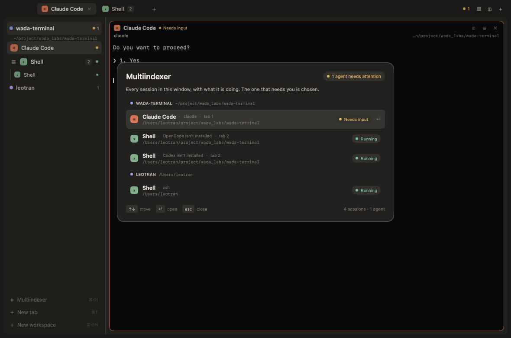

# The Sessions

Wada Terminal runs several agents at once, each in its own pane, tab and
workspace. The Sessions is the window's answer to the question that follows:
*which one needs me now?* It is one index of every session the window holds,
with what each program is doing and a way to give it the keyboard.

The idea comes from [herdr](https://github.com/herdrdev/herdr), *the runtime
your coding agents live on*. Herdr is a terminal workspace manager written in
Rust: it keeps real terminal processes in panes, detects the coding agents among
them, and rolls their state up from panes to tabs and workspaces so the sidebar
shows which project is blocked, which is working, and which is ready to review.
This document records what was taken from it and what was built here.

## What herdr does

Herdr's [concepts](https://herdr.dev/docs/concepts/) define a workspace, a tab,
a pane and an agent; its [agent documentation](https://herdr.dev/docs/agents/)
defines the state model:

| herdr state | Meaning |
| --- | --- |
| `working` | The agent is actively running. |
| `blocked` | The agent needs input, an approval or a decision. |
| `done` | The agent finished and the user has not looked at it. |
| `idle` | The agent is finished or waiting and has been seen. |
| `unknown` | Herdr cannot classify it. |

Herdr finds agents from foreground processes, screen manifests and optional
integrations. For the agents it supports it reads the live bottom of the pane —
not the scrollback — and a detection manifest decides whether that screen means
idle, working or blocked. Blocked detection is deliberately strict: an approval
that no manifest rule matches falls back to idle. State rolls upward: a blocked
agent makes its pane, tab and workspace look blocked, and a done agent stays
visible until it is viewed. Agents can also drive herdr through the CLI and its
socket API.

Wada Terminal is a native window rather than a server with attached clients, so
this first implementation takes the part that makes a multi-agent window usable:
the index, the state, and the way back to the agent that needs you.

## What was built



**The index.** `⌘⇧I`, **View → Sessions**, or the row at the foot of the
workspace column opens an overlay over the page. It lists every session across
every workspace, grouped by workspace and in the order the tabs and splits draw
them. A row shows the program's icon and name, its model or "not installed"
detail, its folder, its tab, and its state. `↑` and `↓` move, Return gives the
chosen session the keyboard, `esc` closes the index, and a click opens a row
directly. Rows scroll into view as the selection moves.

The index chooses its first row with the same priority the window uses
everywhere:

1. an agent that is **blocked** on an approval,
2. an agent that is **done** and unseen,
3. the pane that already has the keyboard,
4. the first session.

**The state.** A session carries four facts, all on the UI thread:

- `busy` — output or a key just reached the pane;
- `blocked` — the live bottom of the agent's screen asks for an approval;
- `done` — it finished while the user was elsewhere;
- `asked` — the user gave the agent work that has not been seen finished.

A 500 ms watcher waits for a working pane to be quiet for three seconds, then
settles it. The bottom twelve non-empty lines of the screen decide `blocked`;
the quiet spell and the focus decide `done`; otherwise the agent is idle. The
watcher starts only while an agent is working and stops when none is, so an idle
window draws no extra frames. Everything it changes belongs to the UI thread;
the worker only asks for a tick through `PostQuiet`.

**What the window shows.** The sidebar's dots follow the state: green while
working, amber for an approval, blue for done, grey at an idle prompt. A
workspace's collapsed row rolls its agents up to the most pressing state, the
title bar counts what needs attention, and a pane's header names the state of
its agent (`Working`, `Needs input`, `Done`). Clicking a done pane, typing in
it, or opening it from the index clears the badge.

## Mapping

| herdr | Wada Terminal |
| --- | --- |
| Agent detected from the foreground process, a manifest, or an integration | The pane's `kind` is known when the session starts; only Claude Code, Codex and OpenCode take agent states |
| State read from the live bottom of the pane | The same: `screenTail` reads the last rows of the emulator's viewport, not the scrollback |
| Blocked when an approval UI matches a manifest rule | A short, conservative list of approval phrases and yes/no choice menus; unfamiliar prompts stay idle |
| Done until the user views it | Done is set when a quiet, asked agent is not the focused pane, and cleared when it is seen |
| State rolls up to pane, tab and workspace | The same dots, plus the workspace header's most pressing state |
| Agent list across workspaces | The Sessions's rows, grouped by workspace |
| CLI and socket API | Not yet: the window is the only way in |

## Deliberate limits

- **Heuristics, not manifests.** An approval dialog with familiar words
  ("Do you want to proceed?", "Allow this command?", numbered Yes/No choices) is
  recognized. A new agent's prompt may read as idle. A prose line that asks a
  question with an action verb can also look blocked, which is why the phrase
  list is short and requires a question mark.
- **Activity, not the process.** A three-second silence is taken as the end of a
  working spell. An agent that thinks for longer can flash `Done` and go back to
  `Working` when it draws again.
- **No notifications or automation.** The title bar counts what needs attention,
  but nothing reaches the desktop notification center, and an agent cannot query
  or drive the window through a socket as it can with herdr.

## Files

- `internal/plugins/terminal/agents.go` — state, the screen scan, the quiet
  watcher and the rollups.
- `internal/plugins/terminal/index.go` — the overlay, its rows and its keys.
- `internal/plugins/terminal/session.go` — the per-session facts the state is
  made from.
- `internal/plugins/terminal/view.go`, `pane.go` — the dots, the rollup, the
  attention count and the pane's state badge.

## Checking it

```sh
go test ./internal/plugins/terminal
```

The tests cover approval recognition against real screens, the idle/done/blocked
transitions, the workspace rollup, the index's order and first row, and the
overlay opening, choosing a row and closing again. A capture with the index open:

```sh
WADATERM_INDEX=1 WADATERM_CAPTURE=/tmp/sessions.png go run .
```
